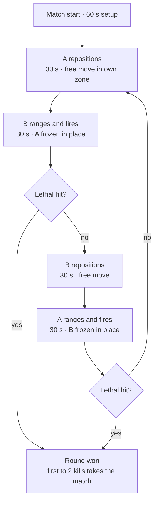
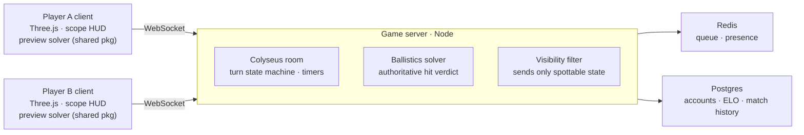

# Sniper Duel — Game Design & Build Plan

_Author: Zubair Rehman · Oct 12, 2026 · transcribed from the original PDF plan_

## Contents

1. [Concept & vision](#concept--vision)
2. [Core loop & turn system](#core-loop--turn-system)
3. [PvE mode (vs AI sniper)](#pve-mode-vs-ai-sniper)
4. [Ballistics simulation](#ballistics-simulation)
5. [Environmental factors](#environmental-factors)
6. [Rifles, ammunition & equipment](#rifles-ammunition--equipment)
7. [Scope, aiming & shooting UX](#scope-aiming--shooting-ux)
8. [Damage model & hit resolution](#damage-model--hit-resolution)
9. [Maps & level design](#maps--level-design)
10. [Multiplayer architecture](#multiplayer-architecture)
11. [Tech stack](#tech-stack-browser-first-mobile-later)
12. [Determinism, fairness & anti-cheat](#determinism-fairness--anti-cheat)
13. [UI screens, audio & VFX](#ui-screens-audio--vfx)
14. [Build roadmap](#build-roadmap)
15. [Risks & open design questions](#risks--open-design-questions)
16. [Handoff notes for the build session](#handoff-notes-for-the-build-session)

---

## Concept & vision

**Pitch:** a 1v1 turn-based sniper duel where every shot is a solved physics problem. You get 30 seconds to reposition, your opponent gets 30 seconds to range you, read the wind, dial the scope and send one bullet. No aim assist, no hitscan — the bullet flies through a full external-ballistics simulation.

**Design pillars (in priority order):**

1. **Real ballistics.** Drop, drag, wind drift, spin drift and air density are simulated, not faked. A player who learns real long-range shooting gets better at the game.
2. **Chess with rifles.** Alternating timed turns reward positioning and prediction, not reflexes. The frozen target makes the shot a pure calculation under time pressure.
3. **One bullet matters.** One shot per turn, long reload, loud report that reveals you. Missing has a cost.
4. **Short, tense matches.** 5–10 minutes, best-of-3 kills, readable at a glance.

**Platforms:** browser first (desktop + mobile web, WebGL), then the same codebase wrapped as iOS/Android apps. Turn-based design means low bandwidth and tolerance for mobile networks.

**Working title:** Longshot Duel (placeholder — open question in Risks).

## Core loop & turn system

A match is a best-of-3-kills duel built from strictly alternating 30-second phases. The shooter always faces a target that cannot move — the mover's protection is the position, concealment and cover chosen before freezing.

**Phase rules:**

- **Move phase (30 s):** free movement inside your zone, stance changes, entering cover. No firing. Clicking Ready ends the phase early — which also denies the enemy watching-time on your dust and movement cues.
- **Shot phase (30 s):** at most one shot. Range, read wind, dial, fire — or deliberately hold fire to stay hidden (a shot reveals your position via flash, dust and sound). Phase ends on fire, Ready, or timeout.
- **Sudden death:** after 16 phase pairs with no kill, wind calms toward zero and each zone's usable area shrinks round by round, forcing exposure.

**Turn cycle — every shot is taken at a frozen target** (4 alternating phases, 2 hit checks):



Setup feeds the four-phase cycle; both fire phases exit through the same lethal-hit check into the round result.

## PvE mode (vs AI sniper)

Same turn loop, same maps, same solver — the bot is just another client whose fire inputs the server (or, offline, the local state machine) resolves. The one hard rule: **difficulty is error injected into the bot's _inputs_, never into the physics.** The bullet always flies honestly, so PvE teaches the exact skills PvP demands.

| Difficulty | Ranging | Wind solution | Fire timing | Positioning behavior |
|---|---|---|---|---|
| Easy | ±8% error | Holds for half the base wind, ignores gusts | Fires anywhere on the sway curve | 3 predictable spots, slow to relocate, always shoots when able |
| Medium | ±3% error | Reads base wind, misses zone layering | Fires near sway center | Full position set, relocates after firing reveals it |
| Hard | ±1% (laser) | Full layered solution, slight gust mistiming | Fires at the sway null with breath held | Punishes repeated positions, pre-aims your last dust cue, bluffs with held fire |

**Implementation:** each turn the bot queries the real solver for the true firing solution, then perturbs it with seeded noise per the table, and fires after a humanlike 8–25 s think delay. One bot brain, three noise profiles — no separate AIs to maintain.

**Where PvE earns its keep:**

- First-session mode and tutorial opponent — playable offline in the browser before any account exists.
- Matchmaking filler: after 60 s in queue, offer an unranked bot match at estimated skill level.
- Progression hook: beating Hard on every map unlocks a cosmetic; PvE stats tracked separately from ELO.

## Ballistics simulation

Use a **3-DOF point-mass model** with standard drag functions (G7 for boat-tail match bullets, G1 fallback). This is what real ballistic solvers (Hornady 4DOF aside) use; 6-DOF is overkill and 2× the bugs for invisible gains at game scale.

Forces on the bullet, integrated each step:

$$
\vec{a} = \vec{g} - \frac{\rho\, v_r\, C_d(M)\, A}{2m}\,\vec{v}_r + \vec{a}_{coriolis}
$$

where `v_r` is velocity relative to the local wind vector (this is how wind drift emerges naturally — **never add wind as a sideways push**), `Cd(M)` is the drag coefficient looked up from the G7 table at the current Mach number and scaled by the bullet's ballistic coefficient, and `ρ` is live air density.

**Effects to model, in build order:**

1. **Gravity drop** — constant g = 9.80665 m/s².
2. **Drag via G7/G1 tables** — ship the standard Cd-vs-Mach tables as data; interpolate linearly. Speed of sound from air temperature, so Mach shifts with weather.
3. **Wind drift** — sample the wind field at the bullet's current position each step (layered wind, see Environment). Headwind/tailwind affect drag; crosswind curves the path.
4. **Air density** — from temperature, station pressure and humidity (ideal gas with vapor-pressure correction). Hot/high-altitude maps shoot flatter.
5. **Spin drift** — use the Litz approximation (lateral drift ≈ 1.25·(Sg + 1.2)·t^1.83 inches, right for right-twist barrels). Matters beyond ~600 m.
6. **Aerodynamic jump** — small vertical deflection from crosswind at the muzzle. Optional, flag-gated.
7. **Coriolis + Eötvös** — from map latitude and shot azimuth. Only noticeable past ~800 m; ship behind a "full realism" toggle.
8. **Transonic destabilization** — when the bullet drops below ~Mach 1.2, add seeded dispersion growth. Creates a real max-effective-range per cartridge.

**Launch conditions (internal ballistics, simplified):**

- Muzzle velocity per ammo type ± a seeded standard deviation (e.g. σ = 4 m/s) — real shot-to-shot variation, deterministic per match seed.
- Cold-bore shift: first shot of the match gets a small fixed offset (loadout-dependent).
- Scope height over bore (~45 mm) and zero distance define the launch angle relative to line of sight.
- Rifle cant: if the player's reticle isn't level, drop rotates into horizontal error.

**Integration:** fixed-timestep RK4 (or semi-implicit Euler at 0.5 ms — benchmark both) in double precision. The solver is a **pure TypeScript function** of `(launch state, environment, seed) → trajectory samples`, no globals, no `Date.now()`. The same module runs on the client for the preview/killcam and on the server for the authoritative hit decision.

**Validation target:** for .308 M118LR and .338 LM reference loads, drop and wind drift must match a published solver (JBM / Applied Ballistics tables) within 1% out to 1,000 m. Write these as unit tests before any rendering exists — roughly a 9–10 mrad drop for .308 at 1,000 m ICAO is the sanity check.

## Environmental factors

Conditions are rolled per match from the map's climate profile (seeded, same for both players) and drift slowly between rounds — so a wind call that worked in round 2 may be stale in round 5.

**Wind (the main skill test):**

- **Layered wind field:** three zones along the lane — shooter, mid-range, target — each with its own base vector. The solver samples the zone the bullet is currently in. Mid-range wind matters most (longest exposure, real-world rule of thumb the game should reproduce).
- **Gusting:** base speed modulated by low-frequency Perlin noise over time (e.g. ±30% over a 10 s period). Firing on a lull vs a gust becomes a timing decision inside the 30 s.
- **Reading tools, not numbers:** the shooter's station shows exact wind at their position only. Downrange wind must be read from visual cues — grass and tree sway, flags on some maps, dust streams, and mirage shimmer through the scope (shimmer angle encodes mid-range wind direction and speed). A Kestrel-style wind meter is equipment, not a free HUD element.

**Atmosphere (affects density and speed of sound):**

- Temperature (per map/time-of-day roll, e.g. 2–42 °C), station pressure from map altitude (sea level to 2,500 m alpine), relative humidity.
- These feed density altitude: the alpine map's thin air gives noticeably flatter trajectories than the humid coastal map — players should feel the difference in their dope.

**Weather states (visual + gameplay):** clear, overcast, light rain and fog bank. Rain and fog cut spotting range and mute muzzle flash visibility; fog can force both players to close distance. Rain adds audio masking (shots harder to localize). No meaningful effect on the bullet itself (real-world rain effect is negligible — stay honest).

**Light & time of day:** sun position per match. Scope glint: aiming with the sun ahead of you shows a brief sparkle at your position to the enemy — a positioning trade-off. Dusk setting lowers contrast on distant silhouettes.

**Terrain interaction:** shot angle (uphill/downhill) handled naturally by the 3-D solver — the cosine effect falls out for free. Air temperature can vary with elevation on the alpine map.

## Rifles, ammunition & equipment

Launch with four rifles built on real cartridge data (approximate published figures — verify against load data during the build). Stats below are the solver's actual inputs, not abstract game numbers.

| Rifle (class) | Cartridge | Bullet mass | Muzzle velocity | G7 BC | Sweet spot | Trade-off |
|---|---|---|---|---|---|---|
| Bolt-action .308 (starter) | 7.62×51 / 175 gr match | 11.3 g | ~790 m/s | ~0.26 | 300–700 m | Forgiving recoil, fast follow-up; goes transonic past ~900 m |
| Bolt-action 6.5 CM | 6.5 Creedmoor / 140 gr | 9.1 g | ~825 m/s | ~0.31 | 400–900 m | Flattest wind call at mid range; lower hit energy |
| Magnum .338 | .338 LM / 250 gr | 16.2 g | ~900 m/s | ~0.32 | 600–1,200 m | Heavy recoil, slow cycle, loud (easier to locate) |
| Anti-materiel .50 | .50 BMG / 660 gr | 42.8 g | ~850 m/s | ~0.36 (G7-equiv) | 800–1,500 m | Punches thin cover; huge flash/dust signature, slowest handling |

Each rifle: cycle time, recoil pattern, sound signature radius, and barrel-mirage buildup after consecutive shots.

**Ammo variants per rifle** (pick in loadout): match (baseline), subsonic (quiet, rainbow trajectory, short range only), AP (penetration bonus vs cover/armor, slightly worse BC).

**Equipment slots (2 per loadout):**

- **Laser rangefinder** — exact distance, but emits a brief detectable glint.
- **Wind meter** — exact wind at your station (without it: estimate from cues only).
- **Ballistic calculator** — suggests a firing solution from your inputs; disabled in Purist ranked mode.
- **Ghillie wrap** — harder to spot while still; slower repositioning.
- **Bipod/rear bag** — cuts sway amplitude ~50% when prone.
- **Armor plate (chest)** — survives one center-mass hit from ≤ 6.5 mm class; adds equip weight.

## Scope, aiming & shooting UX

The scope is the game's whole interface during a shot phase — it has to feel like real glass.

- **Reticle:** mil-based (mrad) tree reticle, first focal plane so subtensions stay true at any zoom. Variable zoom 5–25× (scroll wheel / pinch).
- **Turrets:** elevation and windage dialed in 0.1 mrad clicks with audible/haptic ticks. Players can dial or hold over on the reticle tree — both must produce identical solver results.
- **Ranging without a laser:** mil-relation method — the opponent model has a known torso height (e.g. 0.95 m prone-to-head when crouched); measure it in mils on the reticle, distance = size / mils. Teach this in the tutorial.
- **Dope card:** a small editable note panel where players record their own drop/wind values per range. Persisted per rifle. This is the progression that matters — knowledge, not stats.
- **Sway & breathing:** aim point follows a slow figure-8 (amplitude set by stance: prone < crouch < standing, bipod halves it). Hold-breath key steadies for ~5 s, then sway and heart-rate amplitude grow. Firing is a timing read on the sway curve.
- **Trigger:** single press fires at the current true muzzle axis (sway included). No RNG cone on top — all dispersion comes from sway, muzzle-velocity σ and cant.
- **Parallax/cant:** level indicator in scope; canted rifle rotates drop into lateral miss (solver handles it). Parallax blur at wrong focus setting — optional polish.
- **Shot feedback:** visible trace/vapor on the shooter's own bullet (toggleable in ranked), dust splash on miss with delayed sound, and a bullet-cam killshot replay on lethal hits showing the full curved trajectory — the game's signature moment and its best physics showcase.
- **Mobile touch mapping:** left thumb = drag to fine-aim (gyro assist optional), right side = hold-breath button above fire button; turrets via tap-and-scroll wheels. Design the HUD for this from day one even in browser.

## Damage model & hit resolution

The server intersects the computed trajectory with the frozen target's hitboxes — no health-bar whittling; this is a lethality model.

- **Hit zones:** head/neck = instant kill from any cartridge. Chest = kill if impact energy ≥ 2,500 J (the solver already knows remaining velocity, so E = ½mv² at impact), otherwise "wounded." Abdomen/limbs = wound.
- **Wounds:** a wounded player survives the round but gets +40% sway, slower movement next move phase, and a blood-trail spotting cue. Two wounds = down.
- **Armor plate:** absorbs one chest hit below the energy threshold; .338/.50 class defeats it outright. Plate state shown on the killfeed so players can infer loadouts.
- **Cover penetration:** materials tagged soft (wood, sheet metal, drywall — penetrable with energy loss and small deflection) or hard (concrete, rock, earth berm — stops everything). .50 AP penetrates one soft layer with ~30% energy loss. Penetration = continue the same trajectory integration with a velocity decrement, so wind keeps acting after the exit.
- **Near misses:** a supersonic pass within ~1 m gives the target a directional snap audio cue plus a one-round general bearing indicator — missing leaks information.

## Maps & level design

Each map is two opposing zones with a no-man's-land between them. Players move freely within their zone during move phases (no node snapping — but zones are small, ~60–100 m deep, so 30 s is enough).

**Design rules:**

- 4–6 strong positions per side, each with a distinct silhouette/background so learning the map means learning where people hide.
- Every position has at least two sight lines in and a concealed route between neighbors — no single unbeatable spot.
- Cover mix per position: hard cover to freeze behind + a soft-cover peek that a .50 can punish.
- Readable wind cues placed deliberately: grass bands at mid-range, a flag or smoke column near the far zone.

**Launch maps:**

| Map | Engagement range | Altitude / air | Wind character | Teaching focus |
|---|---|---|---|---|
| Dry Valley | 500–1,000 m | 1,200 m, hot & dry | Steady strong crosswind, visible dust | Wind holds, mirage reading |
| Harbor Rooftops | 250–550 m | Sea level, humid | Light but swirling between buildings | Ranging, quick dials, glint play |
| Alpine Ridge | 600–1,400 m | 2,400 m, cold thin air | Gusty, up/down-slope thermals | Density altitude, incline shots, .50 range |

**Build Dry Valley first** — it exercises every ballistic system with the simplest geometry.

## Multiplayer architecture

Turn-based play makes this cheap: no tick-rate netcode, just a room-scoped state machine that advances on phase events.

**The server simulates, clients only render** (2 clients, 1 authoritative room, 2 stores):



The same ballistics package runs in both places — client for the preview and killcam, server for the verdict. Both clients hold a WebSocket to one Colyseus room. The room owns the phase timers and the match seed, runs the shared ballistics package for every fire input, and streams each player only the opponent state they are entitled to see. Redis backs matchmaking and presence; Postgres keeps accounts, ELO and `{inputs, seed}` replays.

**Match lifecycle:** queue (ELO band) or private code → room created with seeded conditions → loadout lock → setup → phase loop → result written → room disposed.

**Reconnection:** Colyseus session resume with a 60 s grace window; in async mode the room state persists to Postgres between turns and push-notifies the next player.

## Tech stack (browser first, mobile later)

Monorepo, TypeScript everywhere — one language across client, server and the shared physics package is the whole point of browser-first.

```
/packages
  /ballistics   pure TS solver + drag tables + unit tests (no DOM, no deps)
  /shared       match state machine, protocol types, seeded RNG
/apps
  /client       Three.js + Vite
  /server       Node + Colyseus rooms
```

- **Rendering:** Three.js (WebGL2). Low-poly stylized terrain — realistic physics, not realistic graphics; this keeps mobile web viable and art costs near zero. Scope view = second camera with high zoom + overlay reticle, not a shader trick.
- **Client state:** zustand (simple) — turn-based means no ECS needed.
- **Networking:** Colyseus — room-based authoritative state sync over WebSocket, built for exactly this shape of game; reconnection support matters for mobile. Alternative if avoiding frameworks: raw uWebSockets.js + hand-rolled room logic.
- **Server:** Node.js runs the same `/ballistics` package for authoritative resolution. Postgres (accounts, ELO, match history) + Redis (presence, matchmaking queue).
- **Hosting:** Fly.io or Render for stateful WebSocket rooms; Cloudflare in front for static client. A single small instance handles hundreds of concurrent turn-based matches.
- **Audio:** Howler.js; the distance-delayed sonic crack (muzzle report arrives at target after distance/343 s) is a must-have realism cue and trivially cheap.

**Mobile port path (phase 5, not a rewrite):**

1. Browser build is made touch-first from day one (see UX section).
2. Wrap with Capacitor → native iOS/Android shells; add haptics (turret clicks, recoil) and push notifications (async match turns).
3. Only if profiling demands it: move render loop to native — unlikely for this visual budget.

Turn-based design is the enabler here: no tick-rate netcode, tolerant of 3G latency, and it makes an async mode (chess-style, take your turn whenever) almost free — strongly recommended as a retention mode on mobile.

## Determinism, fairness & anti-cheat

The entire anti-cheat strategy is **the server simulates, the client only renders.**

- **Fire input, not fire result:** when a player shoots, the client sends only `{azimuth, elevation, turretElev, turretWind, ammoId, stance, cantAngle, fireTimestamp}`. The server runs the solver against the authoritative environment + seed and decides hit or miss. A modified client cannot invent hits.
- **Timers are server-side:** phase ends when the server says so; a ready click only ends it early. No client clock trusted.
- **Information control:** the opponent's transform is streamed to a client only when the server's own line-of-sight check says that position is spottable from the receiving player's zone. A wallhack can't reveal what was never sent. Concealment (ghillie, fog) is resolved server-side the same way.
- **Determinism:** one match seed drives wind noise, muzzle-velocity σ and condition rolls. Client preview uses the same solver, so the killcam replays the authoritative trajectory from `{inputs, seed}` alone — which also gives free match replays and makes desync bugs loudly visible in testing.
- **Float caution:** cross-platform float drift is why the client never decides outcomes — don't chase bit-identical lockstep; it isn't needed when the server is the referee.
- **Timeout/abandon:** a skipped shot phase = no shot; two consecutive missed phases = forfeit. Async mode uses per-turn clocks (e.g. 24 h) like chess apps.

## UI screens, audio & VFX

**Screens (launch set):** main menu → play (quick match / private code / async) · loadout (rifle, ammo, 2 equipment slots) · match HUD · scope overlay · killcam · results + ELO delta · practice range · tutorial (ranging → dialing → wind, as three 2-minute drills).

**Match HUD (deliberately sparse):** phase + countdown ring, stance indicator, station weather strip (only what your equipment unlocks), the editable dope card, and a round tracker (best of 3 kills). Everything else lives inside the scope.

**Audio (does real information work):**

- Muzzle report reaches the target delayed by distance/343 s — the gap between seeing dust and hearing the shot _is_ the enemy rangefinder.
- Supersonic crack-then-thump ordering for near misses; directional snap cue.
- Wind ambience volume/panning tracks actual station wind — players can hear a gust building.

**VFX:** muzzle flash + ground dust signature scaled by cartridge (the .50's cloud is a spotting gift), bullet vapor trace for the shooter, impact decals per material, scope glint sparkle, mirage heat-shimmer shader in-scope. Killcam: slow-motion follow-cam along the authoritative trajectory with drop/wind annotations — doubles as the game's shareable clip generator.

## Build roadmap

Six gated phases, roughly 16 weeks for a focused solo-plus-AI build. The physics library comes first and everything else is built on top of it — never the other way around. Each band gates the next — a phase starts only when the one above is playable.

| Phase | Scope | Weeks | Exit gate |
|---|---|---|---|
| **P0 Solver core** | Ballistics lib + validation tests vs published tables | 1–2 | Solver tests green vs published dope tables |
| **P1 Practice range** | One map slice, full scope UX, live wind — core feel proven | 3–5 | A hit at 900 m feels earned in playtest |
| **P2 Turn system** | Phase state machine, hotseat + Easy/Medium PvE bot | 6–7 | A full hotseat match plays end to end |
| **P3 Online play** | Colyseus rooms, server verdicts, reconnection | 8–10 | Two browsers finish a ranked match with one mid-match disconnect survived |
| **P4 Content, launch** | 3 maps, 4 rifles, Hard bot, killcam, ELO → soft launch | 11–13 | 50-match soft-launch cohort with no solver-verdict disputes |
| **P5 Mobile wrap** | Capacitor iOS/Android, touch + haptics, store submission | 14–16 | Store builds approved |

Week counts are estimates; the gates are the real contract.

## Risks & open design questions

| Risk | Why it bites | Mitigation |
|---|---|---|
| Stalemate pacing (nobody peeks) | Both players can hide forever | Hard round cap → sudden death: wind calms + exposure zones shrink; wounded-state pressure |
| Realism walls out new players | Mil math + wind reading is a steep curve | Casual mode keeps ballistic calculator + trace on; Purist ranked strips them; 3-drill tutorial |
| Frozen-player frustration | Being shot while unable to react feels bad if unclear | You chose the position — make that explicit; show incoming killcam so every death teaches |
| Mobile-web GPU budget | Three.js + terrain + scope render pass | Stylized low-poly art, single light, scope as camera not shader; test on mid-tier Android early |
| Turn liveness (opponent quits/idles) | Turn games die on abandonment | Server timers + forfeit rules; async mode with push notifications as the retention net |
| Ballistics bugs destroy trust | One wrong dope chart and the sim-community audience leaves | Unit tests vs published solver data gate every solver change (CI) |

**Open questions (decide before Phase 2):**

- Does the frozen player watch the enemy's shot phase live, see nothing, or only the killcam? (Recommend: nothing live, full killcam after — preserves information game.)
- Simultaneous variant (both move, then both shoot) as a second mode worth prototyping?
- Best-of-3 kills vs single-life — confirm in playtest.
- Final name + monetization model (cosmetics/rifle skins vs premium; no pay-for-ballistics).

## Handoff notes for the build session

Work in this order — each step is independently testable:

1. **`/packages/ballistics` first, headless.** G7/G1 tables, RK4 integrator, environment model, the full effect list from the Ballistics section. Acceptance: unit tests matching published .308 and .338 drop/wind tables within 1% to 1,000 m. No rendering until this passes.
2. **Practice range prototype.** One flat Three.js scene, one .308, steel targets at 300/600/900 m, full scope UX (zoom, turrets, mil reticle, sway, hold-breath), live wind with grass cues. This proves the core feel — iterate here until a hit at 900 m feels earned.
3. **Turn state machine, hotseat.** The core-loop phase diagram as a typed state machine in `/packages/shared`; two players on one keyboard. No netcode yet.
4. **Colyseus room.** Lift the same state machine server-side, add fire-input resolution, LOS-gated position streaming, reconnection.
5. **Content pass.** Dry Valley map, remaining rifles, damage/wound model, killcam, then the other two maps.
6. **Meta.** Accounts, ELO, async mode, results screens → soft launch → Capacitor wrap.

**Standing constraints for the builder:**

- The solver stays a pure function; any PR touching it must keep the validation tests green.
- Every gameplay-visible number (BCs, velocities, thresholds, timers) lives in one `config/` data file — tunable without code changes.
- Placeholder art everywhere until Phase 5 of the roadmap; spend the budget on scope feel and audio.
- Touch-first HUD layout from the first screen built.
